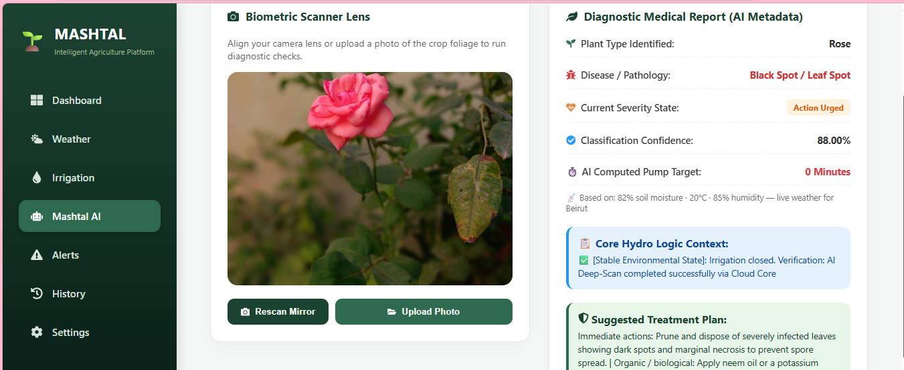
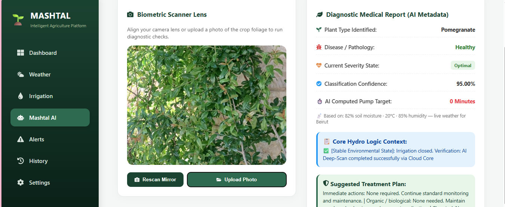
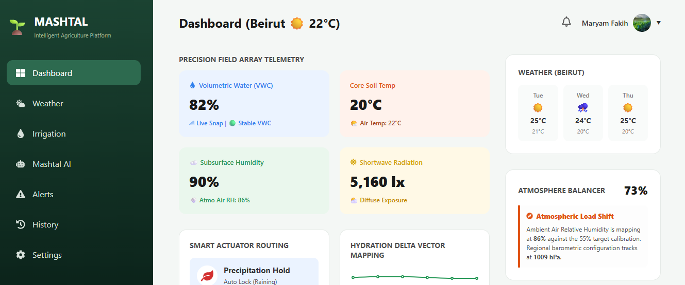
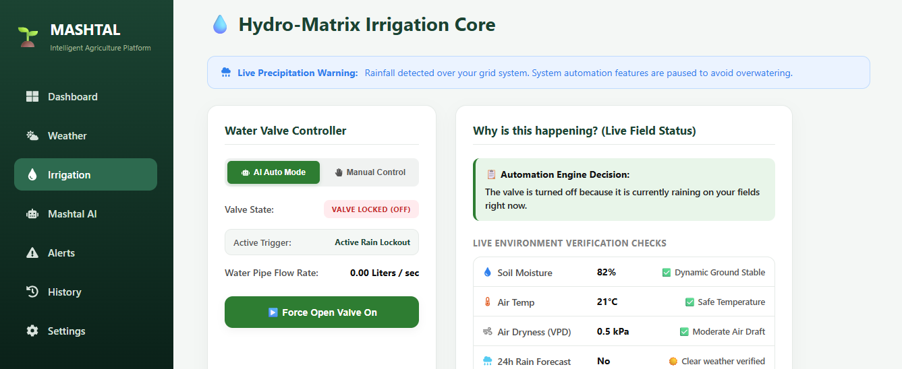
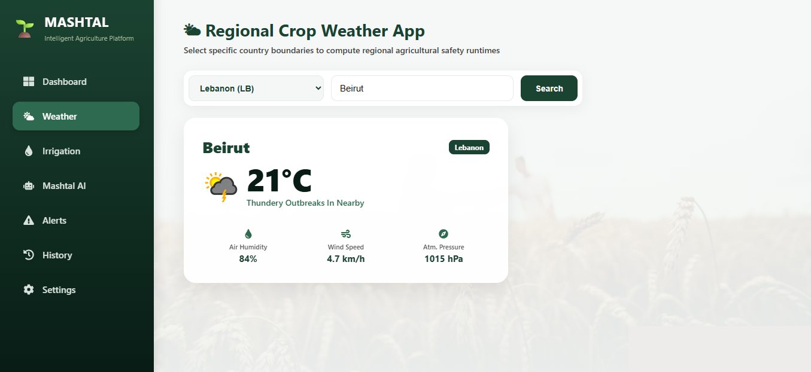
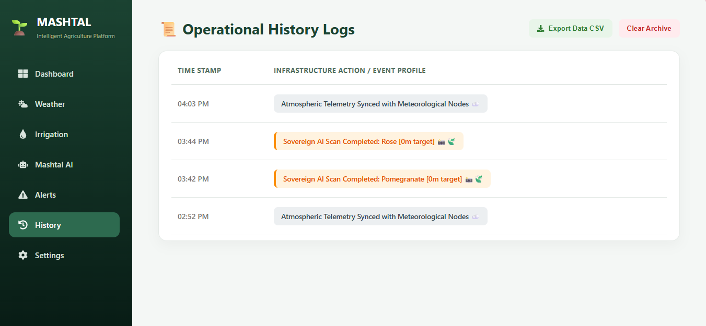
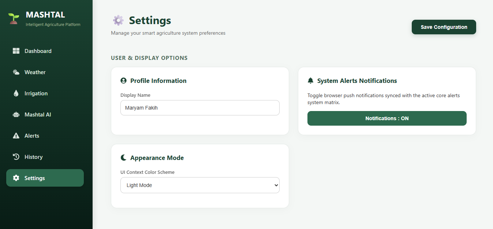
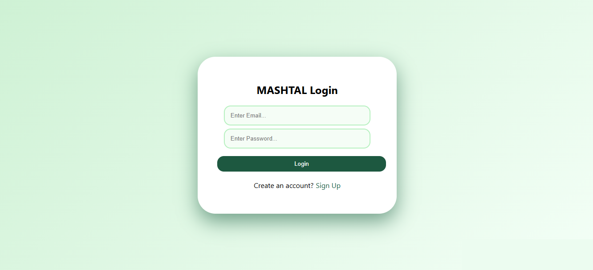
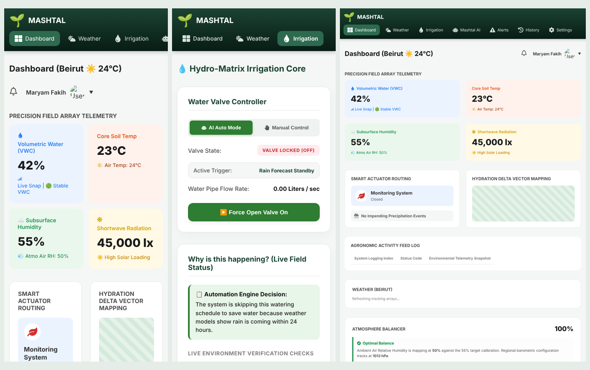

<div align="center">

# 🌱 MASHTAL – Intelligent Agriculture Platform

**Smart irrigation and AI crop-health diagnosis, driven by live weather data.**

### 🔗 [Open the live website → mashtal.onrender.com](https://mashtal.onrender.com)


</div>

> ⏳ The free AI server sleeps when unused, so the **first plant scan can take about a minute** while it wakes up.

---

## 📸 Mashtal AI – plant disease scanner

Upload or take a photo of a plant: the AI identifies the plant, diagnoses diseases or pests, rates the severity and writes a treatment plan (immediate actions, organic options, chemical active ingredients, watering advice and prevention). The irrigation decision is combined with the live weather.

| Diseased plant detected | Healthy plant |
|---|---|
|  |  |

## 📊 Dashboard
Weather-based soil moisture, soil temperature, humidity, solar radiation, 3-day forecast and an atmosphere balance score.



## 💧 Irrigation control
Automatic mode pauses watering when it rains or rain is expected, and explains *why* every decision was made. Manual mode lets you open or close the valve yourself.



## 🌦️ Weather
Live weather for any city, with humidity, wind speed and pressure.



## 📜 History & ⚙️ Settings

| History log (exportable to CSV) | Settings (profile, notifications, dark mode) |
|---|---|
|  |  |

## 🔐 Login


## 📱 Works on phone and iPad
On small screens the sidebar becomes a swipeable top menu and the cards stack into one column.



---

## 🏗️ How it works

```
Phone / laptop ──► Website (React, Render Static Site)
                      │  live weather  ──► Open-Meteo
                      │  login & data  ──► Supabase
                      ▼
                 AI server (Python FastAPI, Render Web Service)
                      │  irrigation model ──► XGBoost (trained by ai-backend/main.py)
                      ▼
                 Google Gemini vision ──► plant + disease + treatment plan
```

| Part | Folder | Technology |
|---|---|---|
| Website | `frontend/` | React, React Router, Recharts, Supabase JS |
| AI server | `ai-backend/` | Python, FastAPI, XGBoost, Pillow, Google Gemini API |

## 💻 Run it on your computer

**1. AI server**
```bash
cd ai-backend
python -m venv venv
venv\Scripts\activate            # Windows  (macOS/Linux: source venv/bin/activate)
pip install -r requirements.txt
copy .env.example .env           # then put your Gemini key inside .env
uvicorn server:app --reload --host 0.0.0.0
```

**2. Website**
```bash
cd frontend
npm install
npm start
```
Open http://localhost:3000

**Retrain the irrigation model** (reads training data from Supabase and writes `mashtal_ultra_ai.pkl`):
```bash
cd ai-backend
python main.py
```

## 🔑 Secrets
API keys are **never** stored in this repository.
- Locally: `ai-backend/.env` (ignored by git)
- Online: Render → Environment (`GEMINI_API_KEY` on the AI server, `REACT_APP_API_URL` on the website)

## 👩‍💻 Author
**Maryam Fakih**, Senior Project
